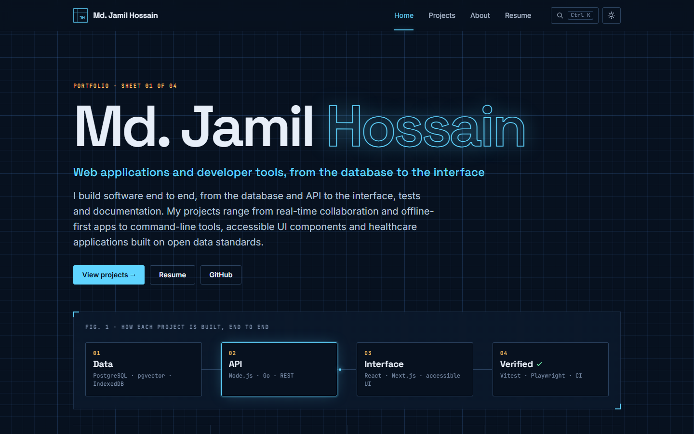

# Portfolio of Md. Jamil Hossain

The source of my personal portfolio site: a short introduction, six selected projects, an index of every public project with a case study for each, and a resume page.

**Live:** https://mdjamilh.vercel.app



## Design

The site is set like a printed report rather than a landing page: warm paper and ink colours, a serif for headings, numbered sections, and hairline rules instead of cards and shadows. It has a dark theme and follows the system setting unless a visitor picks one.

| Part | What it shows |
|---|---|
| Title page | An abstract of my work, keywords, and "the record": repository, commit and deployment counts |
| Selected work | Six numbered projects with links to the case study, the live demo and the source |
| Index of projects | Every project in one table, filterable by domain or technology, with its commit count and last change |
| Case studies | One page per project: problem, approach and evidence, with stack and repository facts |
| Resume | A printable resume generated from the same data, or a PDF once one is added |

Press <kbd>Ctrl</kbd> + <kbd>K</kbd> (or <kbd>/</kbd>) on any page to search projects, technologies and pages from the keyboard.

## The figures are real

The commit counts and last-change dates come from the GitHub API **when the site is built**, so visitors never hit API rate limits and nothing is tracked. If the API is unavailable during a build, the site uses the last snapshot in `src/data/snapshot.json` (refresh it with `npm run snapshot`). A figure that isn't known is left out rather than shown as zero.

## Updating the content

All content lives in two files, so no page needs editing:

- `src/data/profile.ts`: name, abstract, about text, working principles, technologies, contact details and education. Empty fields are hidden.
- `src/data/projects.ts`: every project's summary, problem, approach, evidence, stack and links. `selected: true` puts a project in Selected work.

### Adding a resume PDF

Put the file at `public/resume.pdf` and push. The Resume page then shows the PDF with a download button above the generated version. No code changes are needed.

## Quality

```bash
npm install
npm test            # unit tests: search ranking, filters, GitHub figures and the snapshot fallback
npm run typecheck   # astro check
npm run test:e2e    # browser tests on desktop and mobile
```

The browser tests serve every page with the production Content Security Policy, read from `vercel.json`, so a script the policy would block fails the test. Each page is also scanned with axe for WCAG 2.2 AA issues. CI runs all of the above, plus `npm audit`, on every push.

The policy itself allows no inline scripts or styles and no third-party requests. Fonts are self-hosted, and the only script that runs before the page renders is a small file that applies the saved theme.

## Running locally

```bash
npm install
npm run dev
```

Set `GITHUB_TOKEN` to avoid the unauthenticated API limit during frequent local builds; it is optional.

Built with Astro and TypeScript, using no UI framework. Deployed as a static site on Vercel.

## License

The code is [MIT licensed](LICENSE). The written content and the resume are © Md. Jamil Hossain.
